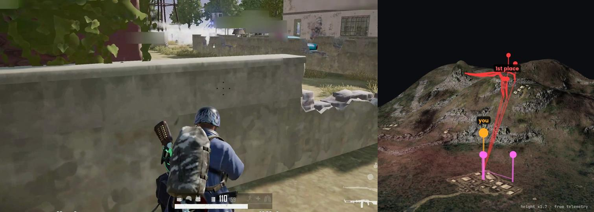
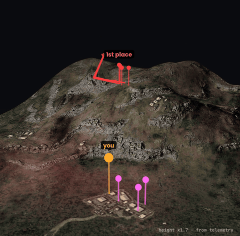
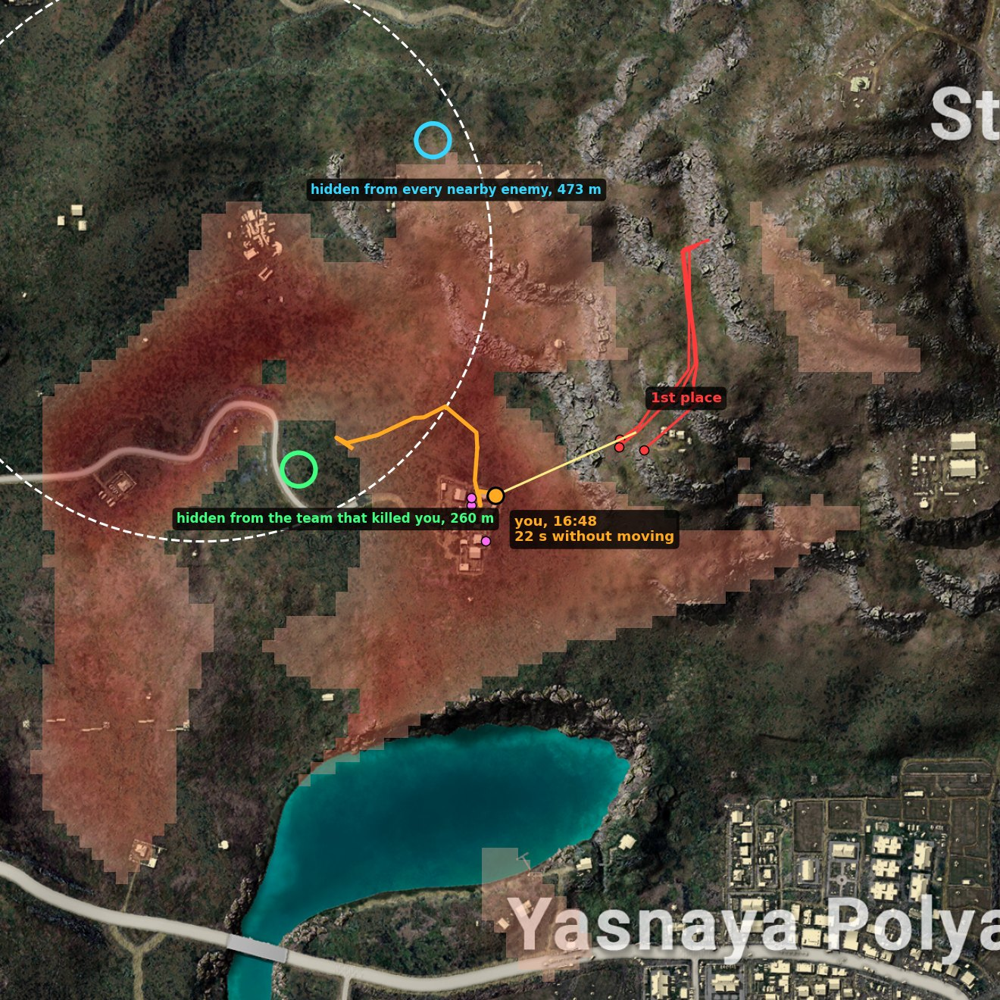
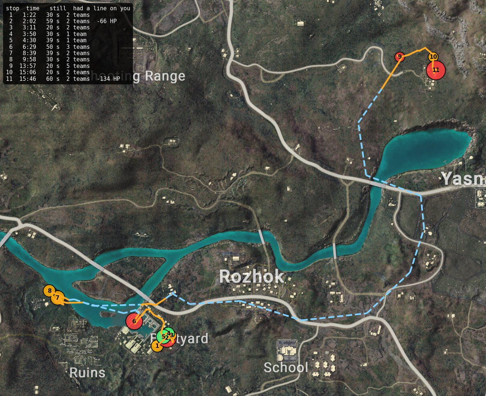
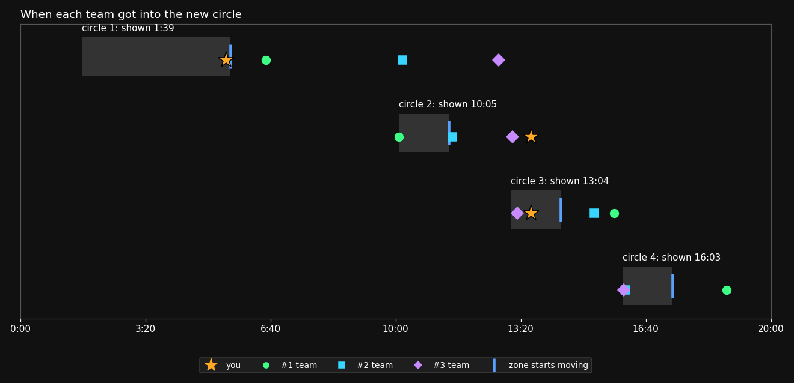
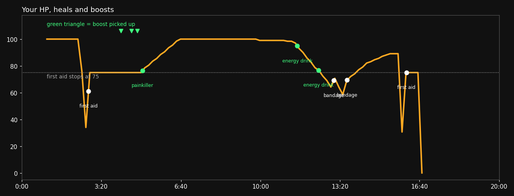
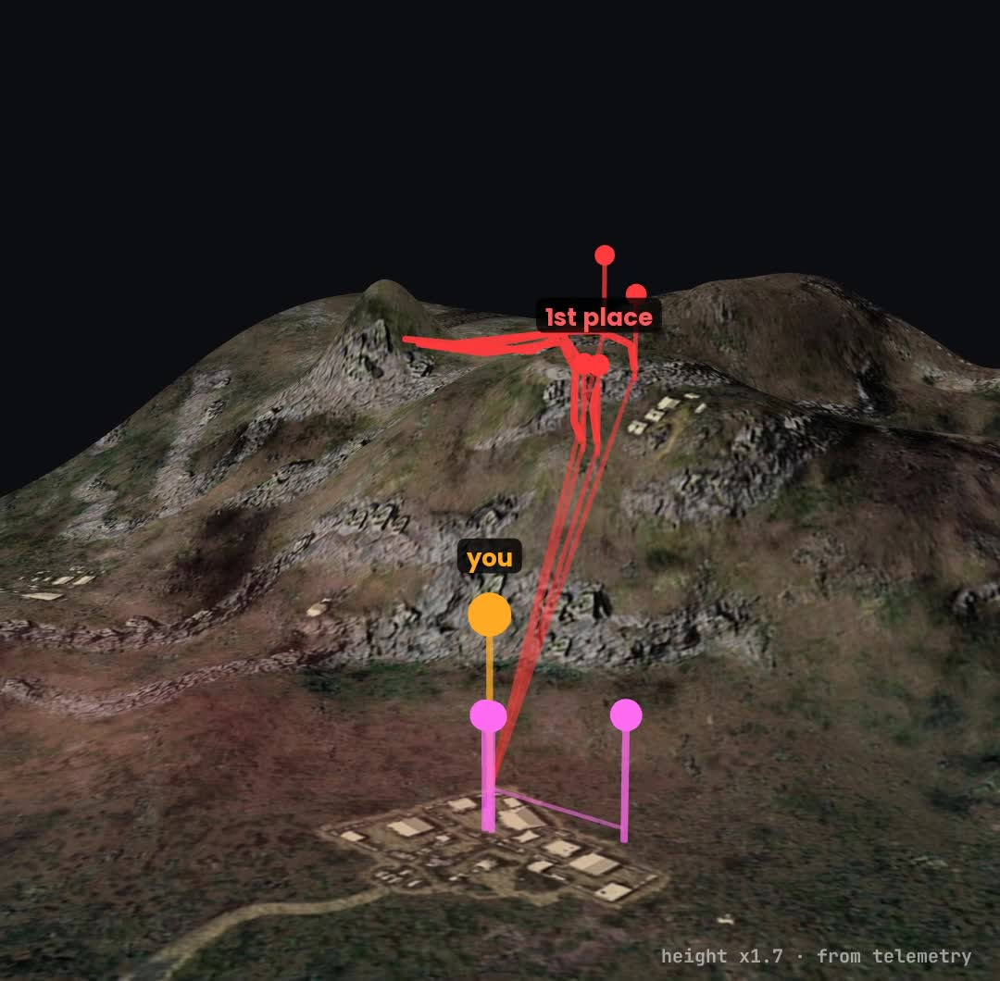

# pubg-coach

**You play by the screen. Pros play by the map.**



<sub>Left: my screen at 16:47, a wall and nobody in sight. Right: the same second on terrain rebuilt from telemetry. The team that won is on the ridge above me, every red line is a clear shot.</sub>

<table>
<tr>
<td width="50%"><br><sub><b>16:16 to 16:48.</b> The winners come over a ridge 100 m above me. 30+ seconds in their sight.</sub></td>
<td width="50%"><br><sub><b>The last minute.</b> Red is ground the high spots can see. Green is a gully 260 m west the ridge could not see into.</sub></td>
</tr>
<tr>
<td><br><sub><b>Every stop of 20 s or more.</b> Colour is how many enemy teams had a line on me.</sub></td>
<td><br><sub><b>Circle timing.</b> The 2nd and 3rd place teams were inside circle 4 within seconds. I was 100 m out.</sub></td>
</tr>
<tr>
<td><br><sub><b>HP and boosts.</b> Both energy drinks went into the blue zone. First aid stops at 75. The AWM did 75.</sub></td>
<td><br><sub><b>Terrain from telemetry.</b> About 11,000 height points from all 99 players.</sub></td>
</tr>
</table>

A post-match coach for PUBG that Claude Code wrote with me. It pulls a match from the official PUBG API, rebuilds the terrain from the telemetry of all 99 players and tells you who could see you, from how high, and where you should have been.

No AI calls at runtime. Claude wrote the code, the code reads the match.

## What it found in my match

Erangel, squad, 10th place. 6 kills, 835 damage. Killed at 16:48.

| question | answer from the data |
|---|---|
| who killed me | the team that won the match, AWM from 201 m |
| from how high | 58 m above me, coming down a ridge |
| how long they could see me | from 16:09, terrain hid nothing |
| what I was doing | standing still for 22 s behind a low wall |
| where I should have been | a gully 260 m west, inside the circle, hidden from the ridge |
| why I had 75 HP | first aid stops at 75, last boost picked up at 4:50 |

Full write-up: **[docs/erangel-breakdown.md](docs/erangel-breakdown.md)** · The last minute as video: [assets/pubg_map.mp4](assets/pubg_map.mp4)

## Commands

| command | what it does |
|---|---|
| `python coach.py last` | quick report of your last match plus an animated replay GIF |
| `python coach.py last 5` | summary of your last 5 matches |
| `python export_v3.py --match-id <id> -o export/match.json` | full anonymised export: every player, position with height, hit, knock, kill, vehicle, heal, circle |
| `python breakdown.py export/match.json` | terrain breakdown: last minute, every stop, circle timing, HP and boosts |

## Quickstart

1. Get a free API key at [developer.pubg.com](https://developer.pubg.com).
2. Install:

```
git clone https://github.com/<you>/pubg-coach
cd pubg-coach
pip install -r requirements.txt
cp .env.example .env
```

3. Put your key and in-game name in `.env`.
4. `python coach.py last` for the quick report, or export a match and run `breakdown.py` on it.

Python 3.10 or newer. `breakdown.py` downloads the official high-res map once (about 100 MB per map).

## How the terrain works

Telemetry has x, y and z for every position, hit and kill. In one match that is around 11,000 points.
`terrain.py` keeps the lowest point in each 16 m cell, filters roofs and parachutes, interpolates the gaps, then:

- checks line of sight between any two players over the terrain
- scores every spot by how many higher spots within 300 m can see it
- finds the nearest low spot inside the circle that a given team could not see

Every real hit is a proven line of sight, so the grid is checked against them: it should never block a shot that actually happened. Around my death spot it let all 99 hits over 40 m through. On a hilly Karakin match it let 131 of 143 through, because steep cliffs are coarse at 16 m. This shows the grid does not invent walls. It does not prove that a spot is hidden.

## Privacy

Your key stays in `.env`, which git ignores. Exports replace every name with `me`, `mate1`, `enemy3` and teams with `T1`, `T2`. No account IDs. Nothing is uploaded anywhere.

## Limits

- Terrain only. Buildings, walls and trees are not in the grid, so towns and forests look more exposed than they are.
- The free key allows 10 requests per minute. The API keeps matches for about 14 days.
- Positions are logged about every 10 s, so second-by-second timings are interpolated.
- `breakdown.py` is tested on Erangel and Karakin. Other maps use the same code and official map files, but have not been checked by hand yet.

## License

MIT
